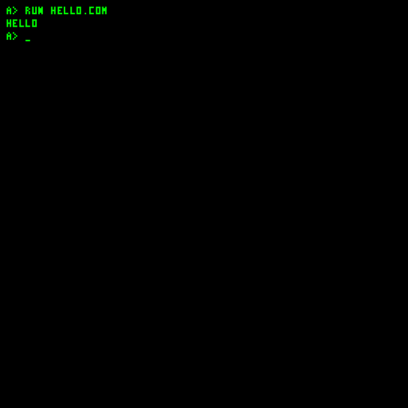

# COM programming

COM files contain flat JavaVCPU instructions. They are not x86 executables. DOS verifies opcode numbers, instruction lengths and register operands, runs files up to 240 bytes in bank 0 page 248, and runs larger linked executables in bank 1 starting at page 0:0. All instructions must stay within a 256-byte code page. Verification does not sandbox a program or prove that its branches and memory accesses are safe.

Register operands use CPU indices: A-H are 0-7 and I-P are 12-19. Indices 8-11 remain control registers. DOS accepts all 20 register slots.

## Stable guest services

The seeded `HELLO.COM` uses guest services to print a greeting and return to the shell:



| Entry | Inputs | Result |
| --- | --- | --- |
| page 249, offset 0 | D = ASCII character; A = return page; B = return offset | Prints one character and jumps back to A:B |
| page 249, offset 9 | None | Returns to DOS shell |

Call using `CHANGE_PAGE_JUMP` with registers containing service page and offset. The service and renderer may overwrite general registers. Reload arguments for each call; do not rely on register preservation. There is no stack-based call instruction.

System image revision 17 adds a shared graphics entry at bank zero, page 249, offset 18. Before using it, read bytes 27..29 of that page and require ASCII `J`, ASCII `G`, and version `1`. The entry takes K/L = X/Y, M = palette color, D = character, and E = rendering mode (0 = transparent 3x5 glyph, nonzero = opaque 4x6 cell with a black background). N/O/P specify the return bank/page/offset. Enter with `CHANGE_BANK_PAGE_JUMP`; the routine preserves N-P and all RAM but clobbers A-M. Coordinates wrap as bytes and unsupported characters draw `?`. It draws into the current framebuffer without calling `DISPLAY` or changing storage selection. The mode and register constants are documented in `JvDosServices.java`.

This graphics entry is available to native guest code. JCTRL's sandboxed COM interpreter continues to expose only the print and completion services listed below.

To print H and return to program byte 18:

```text
02 48 03    # STORE 72 D
02 F8 00    # STORE 248 A (return page)
02 12 01    # STORE 18 B (return byte offset)
02 F9 06    # STORE 249 G (service page)
02 00 07    # STORE 0 H (print entry)
0A 06 07    # CHANGE_PAGE_JUMP G H
```

Return to DOS using:

```text
02 F9 06 02 09 07 0A 06 07
```

CPU opcode `STOP` halts the machine; it is not a DOS return. JVS `STOP` is interpreted differently and returns to the shell.

`examples/dos/HI.hex` contains three print calls (H, I, newline) and a prompt return. `examples/build.ps1` creates `HI.COM`; import the COM as Binary / COM through Workshop, then `RUN HI.COM`. Do not import the commented hex as executable content.

## Memory ownership

In bank 0, the guest uses pages 246 for font pointers, 247 for instruction descriptors, 248 for the transient program, 249 for service trampolines, and 250-252 for names, input and kernel variables. Pages 253/254 hold extended filesystem state and scratch; the bootstrap uses page 255. Resident kernel/font/image data occupy other pages. Limit a small COM to its transient area and documented services; bank 1 is the file buffer and becomes the code area when a larger COM executes.

DOS's validator walks the whole file as instructions, so embedded arbitrary data can be rejected. Instruction operands must fit inside the file and each fetched instruction must fit inside its page. The loader leaves the rest of transient RAM unchanged. Do not branch into stale bytes after the program's end. See [Instruction set](Instruction-set) for byte lengths and operand conventions.

## Extended RAM

Bank 1 provides a separate 64 KiB for program data and code. Use opcodes 24/25 to read/write it from bank 0, and opcode 23 for cross-bank jumps. All DOS services live in bank 0; return from bank 1 with `CHANGE_BANK_PAGE_JUMP` specifying bank 0, page 249, offset 9. Ordinary page jumps retain the bank. The COM file limit is 61,200 bytes, subject to free blocks. Larger COM files begin in bank 1; they must explicitly select bank 0 to call DOS services or return to its prompt. Small COM files keep the original ABI. The counter still wraps within a page: use explicit page jumps to continue code across pages.

RAM bank-one pages 240-250 are reserved for the shell history, draft line, and completion buffers. Preserve them when using bank-one RAM outside the loaded COM/file region.

## Storage and networking

Control register 10 selects the storage medium for opcodes 18/19; preserve the caller's value when returning to DOS. Opcodes 29/30 provide byte access to a separate TCP controller register bus. See [Peripheral buses](Peripheral-buses) for the protocol and `NETECHO.COM` example.

## JCTRL guest program runner

JCTRL can interpret small COM programs inside its application window without changes to the Java CPU or ISA. It supplies an 8 KiB virtual code/data workspace and a 128?128 RAM-backed pixel buffer. Small programs retain virtual 0:248 placement; larger ones start at virtual 1:0. Guest-handled DOS entries 0:249:0 and 0:249:9 provide character output and completion. STOP finishes the interpreted application while the real VM's STOP behavior remains unchanged. See [the desktop guide](Experimental-desktop.md) for supported JVS commands, memory limits, graphics scaling, and media playback.
