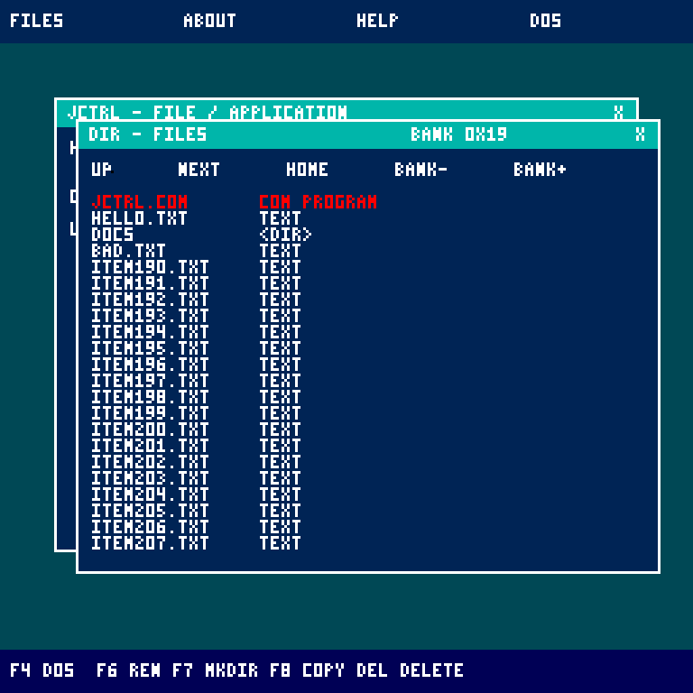
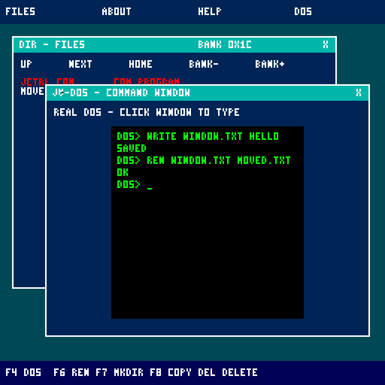
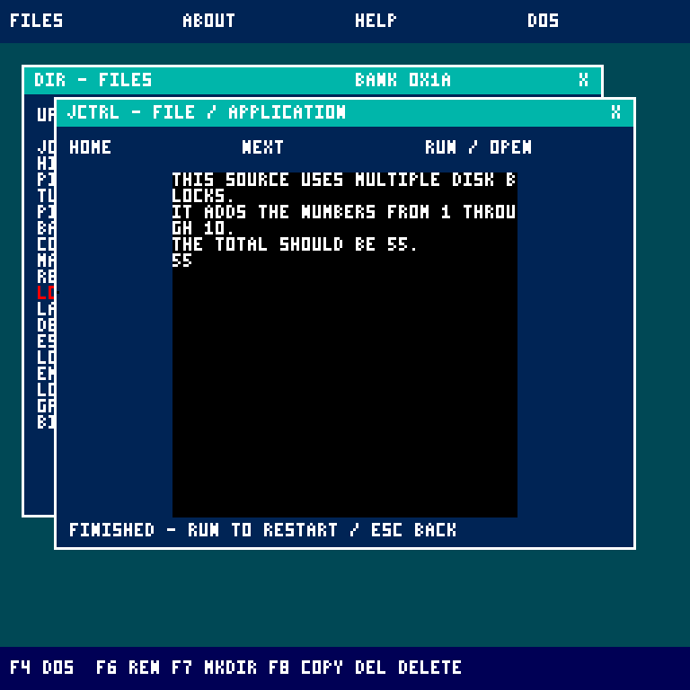
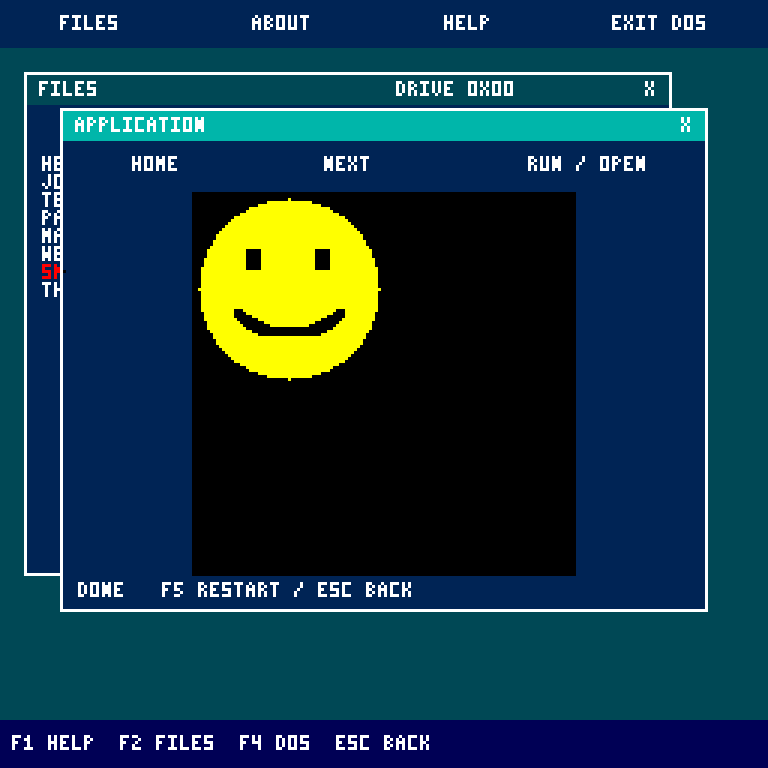

# Experimental DOS desktop

The desktop is a separate JavaVCPU guest application, `JCTRL.COM`, launched with the `JCTRL` command (or `RUN JCTRL.COM` for a manual copy). DOS remains resident underneath it. Its windows, file browser, and text renderer run entirely on the guest CPU, using the existing instruction set, 128 KiB RAM, and normal device ports.

## Install and start

Start the VM and enter `JCTRL`. The installer keeps a managed `JCTRL.COM` in the root of system disk 0. Its ownership record (bytes 256..295) stores the physical entry address and SHA-256. An unchanged managed copy can be updated independently of the kernel. Manual/modified copies, full disks and corrupt volumes are preserved. JV-DOS 2.0 requires a freshly formatted JVFS disk; older experimental formats are reset on startup.

For a manual copy, stop the VM, open `storage.img` in Workshop, select a folder and click **Add JCTRL desktop**, then download and replace the disk while stopped. Alternatively import `examples/dos/JCTRL.COM`. Launch a manual copy with `RUN JCTRL.COM` in its folder. Manual copies are not automatically updated.

The desktop opens the current folder on the currently selected storage device. Browsing and viewing do not modify files. Drag-and-drop and DOS file commands persist changes to the selected disk. Explorer navigation stays separate from DOS's location; commands in the DOS window update the real shell's location.

## Windows and applications

| Tool | Supported behavior |
| --- | --- |
| Files (`DIR`) | Lists folders and files, follows child and parent folders, and pages large directories. Up/Down selects a highlighted row; Enter opens it. Page Up retraces directory pages; Home resets paging history. File rows identify COM programs, text, palette images, and music. Click text/JVS files to read them; COM, palette images, and music open directly. DRIVE- / DRIVE+ switches the browser drive without changing DOS's selection. The title shows the device ID in hexadecimal. |
| Text (`VIEW` / `TYPE`) | Reads streamed text/JVS files in a clipped window with next-page and Home navigation. CRLF is accepted; tabs display as a space. Invalid chains stop with an error. |
| System (`VER` / `MEM`) | Shows DOS version, installed RAM, and the desktop's execution model. |
| Help (`HELP`) | Shows desktop controls in the system window. |

## DOS window and file operations

Press **F4** to open or focus the existing DOS shell in the application window. This runs the resident DOS bytecode and its original parser, history, completion, editor, and filesystem routines through the guest interpreter; it is not a replacement command parser. Drag its title bar to move it. Only the focused application window receives keyboard events, including key-state reads. Click Files or press F2 to use the explorer without typing into DOS. Close with X; F4 reopens it. Esc goes to DOS for command cancellation while this window is focused. Use the top toolbar's DOS button to leave JCTRL.

The DOS window shares the single application execution slot with COM/JVS programs and media. Its file/program buffer is limited to the existing 8 KiB guest workspace; oversized loads report a DOS error. Text uses the original font at window geometry rather than scaling a fullscreen console. DOS display geometry lives in bank-zero state page 252, bytes 24..26 (wrap X, scroll trigger Y, post-scroll Y); JCTRL restores fullscreen geometry when returning to DOS. Normal startup updates the managed desktop together with the resident system; reimport manual copies after rebuilding.

In Files, press and drag an entry onto a visible folder on the same drive, then release to move it. A click without movement still opens it. A move updates only the directory entry and parent record; names, file contents, and linked blocks remain intact. Drops outside a folder, duplicate destination names, self-drops, and cyclic or corrupt destination ancestry are rejected without writing. Cross-device drag/drop and modifier-key copying are not supported yet.

Explorer operations prepare commands in the real DOS window:

| Key in Files | Prepared command |
| --- | --- |
| F6 | `REN selected-name ` - type the new name |
| F7 | `MKDIR ` - type the folder name |
| F8 | `COPY selected-name ` - type the destination name |
| Delete | `DEL selected-name ` (or `RD` for folders) |

Commands are not executed until Enter is pressed; edit or cancel them first. Operations start a fresh prompt at the explorer's drive/folder and are ignored while the existing DOS window is busy or editing. F2 returns to Files and refreshes the list after a command. The original DOS commands also provide `MOVE`, `DELETE`, `RENAME`, `WRITE`, `EDIT`, `APPEND`, `RD`, and other file operations.

## Programs and media

Click a COM file to run it. For JVS source, open it in the text reader and click **Run / Open** or press **F5**. JCTRL opens its DOS console, queues `RUN filename` and executes it through the resident DOS parser, filesystem loader and JVS interpreter. Output remains in the console; run again from its prompt or reopen the source. COM output appears in the application window. COM execution and the shared DOS window are covered by guest regressions.

The program runner is an interpreter **written in guest bytecode**. It executes inside the original machine, with an explicit 8 KiB code/data workspace and 128x128 pixel buffer allocated from guest RAM. It does not modify the Java CPU, install VM hooks, snapshot host memory, add opcodes, or provide native preemptive multitasking. One program or music stream runs at a time, yielding to JCTRL's event loop. Its output survives window dragging because it lives in guest RAM. Esc stops interpreted applications and returns to the desktop; X closes their window. The focused DOS window handles Esc itself. Stopping an interpreted STOP instruction finishes that application; the VM's STOP instruction itself is unchanged.

COM compatibility includes all current opcode forms, with bounds checks on virtual registers, instruction fetches, and application RAM accesses. Small COM files start at virtual bank 0 page 248; larger files start at virtual bank 1 page 0. Virtual bank-one pages 0..31 provide the 8 KiB workspace; legacy bank-zero page 248 aliases its first page. Branches and code fetches must remain within the loaded file. Bank-zero DOS entries 249:0 and 249:9 are handled by the guest interpreter for print-and-return and application completion. The filesystem entry 249:30 is also supported, with block buffers mapped into the application workspace; RESET is reserved for boot. Other DOS internals and memory outside the workspace are unavailable. Graphics coordinates are reduced from 256x256 into the 128x128 buffer, while text uses a 32-column console. Storage/network/audio operations use the existing guest device instructions; normal application disk writes are persistent.

JVS uses the full resident DOS language, including comments and `CLEAR`; JCTRL no longer embeds a second source interpreter, tokenizer, number parser, register parser or line scanner. The DOS window keeps the existing 8 KiB file-buffer limit and checks Esc between statements. Source remains cooperative: the desktop can repaint, move windows and deliver cancellation while the resident interpreter runs.

Palette images (`JI`, type 2) stream across linked blocks directly into the guest pixel buffer. Images up to 128x128 use their original pixels; larger images, up to 240x240, reduce both dimensions by two. The image does not require a full-size second framebuffer or a complete file buffer.

Music (`JM`, type 3) supports versions 1 and 2, eight voices, and the existing frame/note/control event format. Playback advances through the guest event loop so windows remain usable. Esc, X, opening another file, or the end of a tune silences all voices. Zero-duration events are processed in bounded batches to retain keyboard/mouse responsiveness. Unchanged windows are retained between ticks: music waits and programs that have no visual updates skip desktop repainting. Pixel writes only mark the surface dirty when its color changes; completion and errors refresh the status. The framebuffer blit keeps its traversal in CPU registers to reduce memory traffic when repainting is required.

`DISPLAY` atomically swaps a completed drawing buffer into the presenter; Swing paints only that front buffer. The next drawing buffer retains the previous pixels so incremental graphics continue working. Pixel writes and clears remain invisible until `DISPLAY`. This isolates guest rendering from presentation, but does not provide hardware vsync.

`DISPLAY` uses a monotonic 33 ms target interval. Guest execution consumes that budget, so presentation waits only for the remaining time. Overruns rebase the next deadline without catch-up bursts. Sustained-note regression checks require fewer than 1,000 guest instructions per idle playback tick and zero pixel writes. They also verify note durations and zero-duration event grouping. Window dragging and other expensive UI operations can still delay playback; music still counts display intervals rather than reading an independent clock.

Ordinary pointer motion saves and restores the two pixels beneath the cursor, using four pixel writes per move instead of repainting the desktop. Window dragging and changed application surfaces still repaint normally. Palette reads round to the nearest encoded color so repeated background restoration preserves every color exactly. Regression checks use the real RGB framebuffer and buffer swaps, covering all 128 palette colors, repeated motion over window/desktop colors, overlapping cursor positions, wrapping at screen edges and window redraws.

JCTRL and media share the full drive. DRIVE- / DRIVE+ scans mounted devices, stops the active application and selects the chosen volume's root. The file explorer has 22 visible rows per page and retains the last 85 page starts; forward paging continues beyond that history. No swap file or hidden cache is used.

Drag a title bar to move its window; click any visible part of a window to bring it forward. X closes the window. The toolbar reopens Files, About, and Help; DOS exits the desktop. There is one instance of each tool window.

| Key / input | Action |
| --- | --- |
| F1 / F2 / F3 | Help / Files / system information |
| Esc | Cancel in focused DOS; stop/back from another application; return to DOS from the desktop |
| F4 | Open/focus the resident DOS window |
| F6 / F7 / F8 / Delete in Files | Prepare rename / new folder / copy / delete in DOS |
| F5 / Run / Open | Execute the opened program/source file |
| Home | First page in the focused file or text window |
| Space / Page Down | Next page in the focused file or text window |
| Up / Down in Files | Select the previous / next visible entry |
| Enter in Files | Open the selected entry |
| Page Up in Files | Return to the previous directory page |
| Backspace in Files | Parent folder |
| DRIVE- / DRIVE+ | Browse another mounted drive |
| Wheel down / up | Next page / first page in the focused tool |

## Resident DOS services

System image revision 23 provides JVFS ABI v1 alongside graphics ABI v1. Startup upgrades the kernel and managed desktop together. If either signature is missing, JCTRL returns to DOS before initialization. Desktop filesystem calls use their own mailbox/handle; DOS-window calls enter the shared guest driver atomically so repainting cannot corrupt paused filesystem work.

DOS and JCTRL now share one resident glyph renderer through bank-zero service `249:18`. Both use the existing font table; DOS requests opaque 4x6 character cells and JCTRL requests transparent 3x5 glyphs. The renderer keeps its scratch values in registers and writes no RAM, so desktop drawing cannot corrupt a paused DOS-window operation. The existing print and shell service addresses remain unchanged. See [COM programming](COM-programming.md) for the service contract.

The machine still has 128 KiB RAM and the application workspace remains 8 KiB. COM virtualization, windows and streamed media run cooperatively in guest bytecode. Guest applications can call filesystem entry 0:249:30 with a mailbox in their workspace; the desktop translates that call and reserves handle 3 for the application. Raw hardware storage operations retain their existing behavior.

## Application layout and rebuilding

`DesktopImage.java` emits a flat executable using the existing instruction set. The ordinary COM loader validates it and runs it in RAM bank one at page 0, offset 0. Executable instructions stay below page 128. If literal pages overflow into 128..135, startup copies only the loaded overflow into reserved pages 234..239 and 231..232 before the application workspace is used. The current compact image has no overflow and skips copying. All literal references are relocated by the assembler; this uses only ordinary guest loads and stores. Strings are packed into literal operands of nonexecuted data instructions so the existing validator can check every instruction, including the data pages.

The application memory layout is entirely within the original 128 KiB:

| RAM bank one pages | Ownership |
| --- | --- |
| 0..127 | Resident JCTRL code and literal data |
| 128..159 | 8 KiB interpreted program code/data or JVS source |
| 160..223 | 16 KiB, 128x128 palette application framebuffer |
| 224 | Desktop/window state |
| 225 | Guest interpreter and media state |
| 226 | Reserved |
| 227 | Directory row-to-entry address map (3 bytes per row) |
| 228 | Virtual application registers |
| 229 | Explorer directory-page history (85 retained page starts) |
| 230 | Focused DOS keyboard queue |
| 231..232, 234..239 | Relocated immutable literals |
| 233 | Desktop filesystem mailbox |
| 251 | DOS path buffer |
| 252 | DOS block-copy buffer |
| 253 | DOS document-page history |
| 240..250 | Existing DOS history/draft buffers, preserved |

Bank-zero DOS and its font table remain resident; the renderer reads the font through ordinary bank-zero loads. Mouse input uses existing ports 0x30..0x33. The bytecode interpreter implements a dynamic READ_INPUT port by patching one literal operand in its own guest code, using normal RAM writes.

On exit it clears the screen, resets the shell's text position, and uses `CHANGE_BANK_PAGE_JUMP` to return to the stable DOS entry at bank 0, page 249, offset 9. These desktop and DOS changes do not add VM opcodes or host memory snapshots; `Memory.java` is unchanged by this work.

Run `gradlew.bat desktopImage` to regenerate `examples/dos/JCTRL.COM` and `tools/disk-workshop/desktop.js`. `storageRegression` checks actual guest filesystem operations, large files/directories, corruption, full-disk recovery, package ownership, glyph rendering, cursor restoration and Pong. `browserRegression` checks WEB with a local HTTP fixture. Disposable images and previews live under `build/`.

The assembler performs branch relaxation before writing the executable: same-page unconditional and equality branches use `JMP` (2 bytes) and `COND_JUMP` (4 bytes). Cross-page targets retain `CHANGE_PAGE_JUMP` and `CHANGE_PAGE_COND_JUMP` sequences. It recomputes labels and page layout after each change; any shortened branch that crosses a page boundary in a later pass is pinned to its far form. This also relocates string pointers, return addresses, and the self-modifying input operand. The build prints baseline/optimized byte counts and selected branch counts. The assembler also checks that executable instructions remain below page 128 and relocates overflow literal pages into their reserved guest RAM area.
