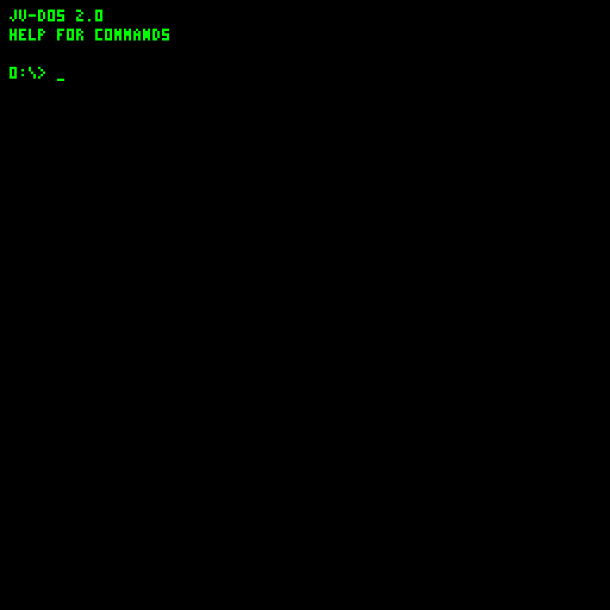

# JavaVCPU wiki

JavaVCPU is an experimental Java virtual machine with a byte instruction set, 128 KiB of banked, paged memory, a palette framebuffer, keyboard/mouse input, synthesized audio, and a persistent 16 MiB disk. JV-DOS 1.3 is its resident guest operating system, assembled into the same instructions that user programs execute.

Start with [Getting started](Getting-started). Open [Tooling and Disk Workshop](Tooling-and-Disk-Workshop) to move host files onto a virtual disk, or [Example programs](Example-programs) to run your first program.

Browse [Screenshots](Screenshots) for every display view, media tool and Disk Workshop view.

| Guide | Contents |
| --- | --- |
| [Screenshots](Screenshots) | Boot, shell, help, editor, viewers, program output, graphics demos and Workshop |
| [Getting started](Getting-started) | JDK 26, builds, launching, boot flow, project map |
| [Architecture](Architecture) | Registers, pages, display, input, audio and storage |
| [Instruction set](Instruction-set) | All 29 opcodes and operand conventions |
| [JV-DOS](JV-DOS) | Commands, editing, viewing files and media |
| [JVS programming](JVS-programming) | Source syntax, arithmetic, loops and limits |
| [COM programming](COM-programming) | Raw guest bytecode and DOS service ABI |
| [Tooling and Disk Workshop](Tooling-and-Disk-Workshop) | Offline imports, conversion, exports and troubleshooting |
| [Disk and media formats](Disk-and-media-formats) | Boot header, directory records, image/music formats |
| [Example programs](Example-programs) | Bare-metal and DOS examples with expected output |

These pages describe the current working-tree implementation. Names such as `JVCPM`, `MicroDOS` and `DEMO_OS` remain in source and boot messages; the interactive guest identifies itself as JV-DOS 1.1. This is a custom VM and guest OS: COM files contain JavaVCPU opcodes, and JVS is a small line interpreter.

Source: [JavaVCPU repository](https://github.com/Infer4Y/JavaVCPU). The repository stores these editable wiki sources in `docs/wiki/` and programs in `examples/`.
