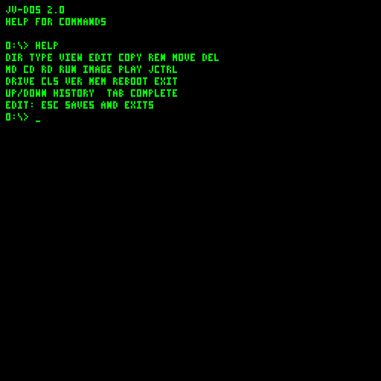
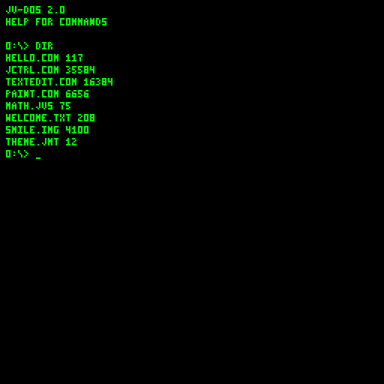
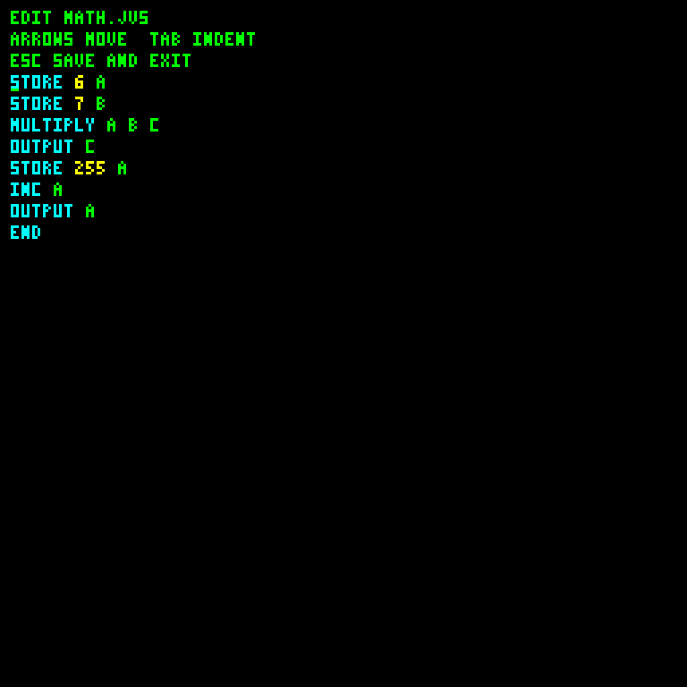
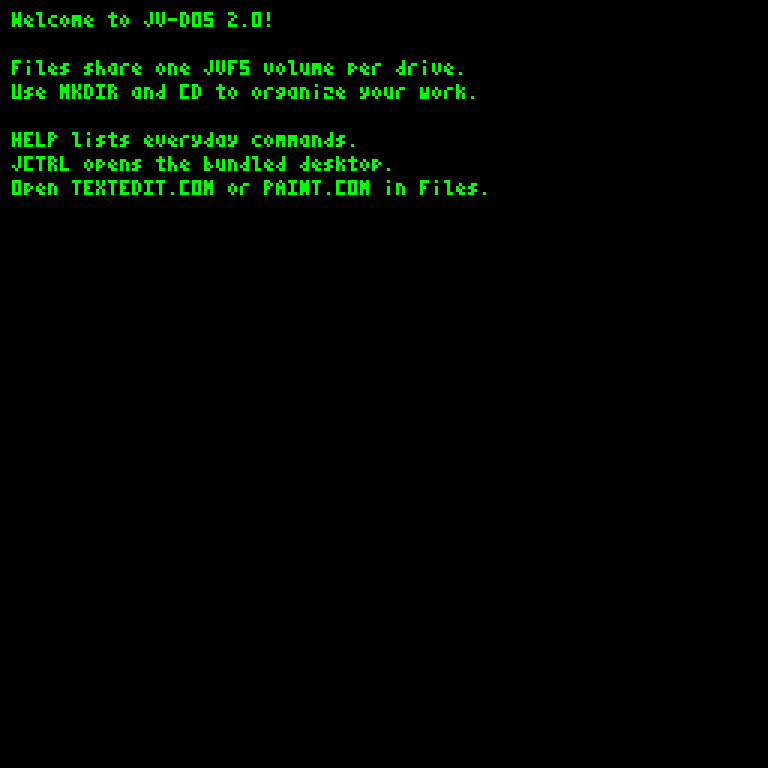
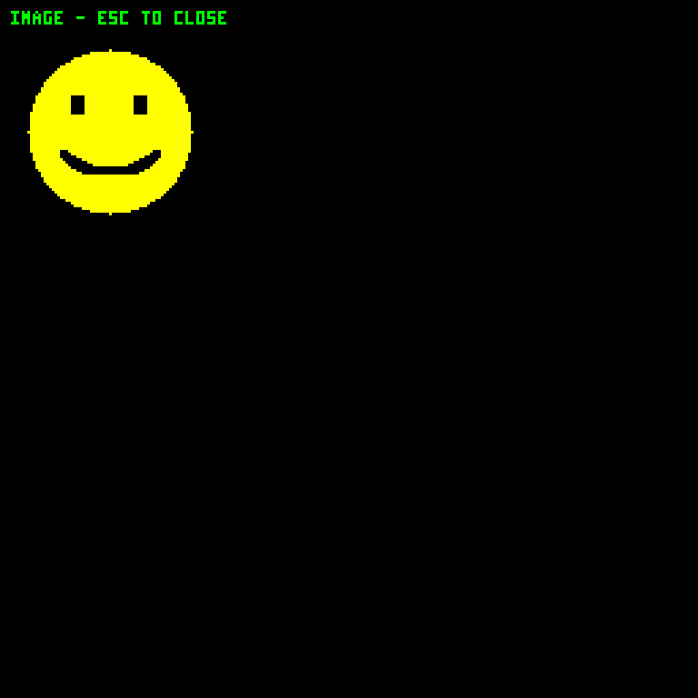
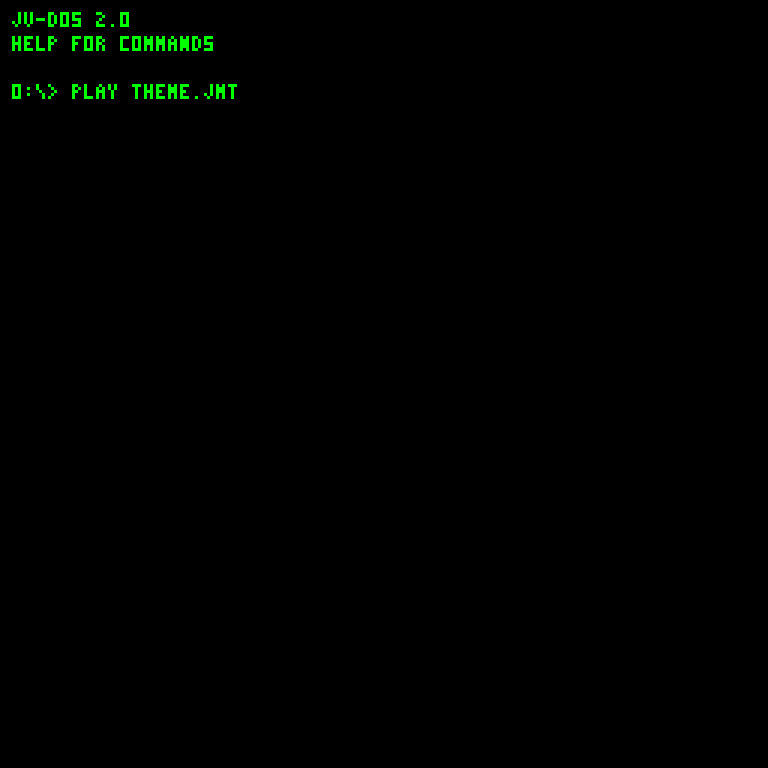

# JV-DOS 2.0

JV-DOS runs as guest bytecode. It provides a shell, persistent named files, an editor, JVS interpretation, COM loading and small media viewers. Commands and filenames should be uppercase. Click the VM window before typing.

Startup uses a short banner and silent keyboard input. `SOUND ON` enables clicks. The prompt shows the drive and directory (`0:\DOCS\>`). `HELP` lists everyday commands; programming syntax lives in the [JVS guide](JVS-programming.md). CODEHELP and bank selection have been removed from the shell.

Programs can launch directly: enter `HI.COM`, `DEMO.JVS`, or a bare name such as `HI`. DOS first checks built-in commands, then searches the current folder for the exact filename, then a `.COM` suffix, then `.JVS`. Only executable/source file types launch this way; directories and media require their usual commands. Direct launches accept no arguments and do not extend the COM ABI. JVS source retains its existing restricted statement set.

| Command help (`HELP`) | Directory (`DIR`) |
| --- | --- |
|  |  |

| Command | Purpose / example |
| --- | --- |
| `HELP` | Everyday shell commands |
| `DRIVE`, `DRIVE N` | Show/select a mounted storage device (0-255); resets to the volume root |
| `INSTALL FILE.COM` | Copy a binary program from the current folder to drive 0 root; preserve the source and refuse collisions |
| `MV FILE.COM 0:` | Move a binary program to drive 0 root; delete the source only after successful commit |
| `DIR` | List the current folder; folders show `<DIR>` |
| `MKDIR NAME`, `MD NAME` | Create a folder |
| `CD NAME`, `CHDIR NAME` | Enter a child folder |
| `CD ..`, `CD /`, `CD \` | Go to the parent or volume root |
| `RMDIR NAME`, `RD NAME` | Remove an empty child folder |
| `TYPE NAME`, `CAT NAME` | Print file contents directly |
| `VIEW NAME`, `MORE NAME` | Read a document with navigation |
| `WRITE NAME TEXT` | Create or replace text |
| `APPEND NAME TEXT` | Append text to an existing file |
| `EDIT NAME` | Create/open a file in the editor |
| `COPY OLD NEW` | Copy to a new name |
| `REN OLD NEW`, `RENAME OLD NEW` | Rename a file to an unused name |
| `MOVE NAME DEST` | Move a file/folder into a sibling folder, or rename it to an unused name |
| `MOVE NAME ..`, `MOVE NAME /` | Move a file/folder to its parent or volume root |
| `DEL NAME`, `ERASE NAME`, `DELETE NAME` | Delete a file |
| `SAVE NAME HEX` | Create binary content from uppercase hex byte pairs |
| `JCTRL` | Launch the bundled desktop on system disk 0 |
| `RUN NAME` | Interpret text, load bytecode, or open image/music by type |
| `IMAGE NAME`, `SHOW NAME` | Display a palette image |
| `PLAY NAME` | Play a MIDI-note stream |
| `BROWSE HOST/PATH` | Basic HTTP text reader; optional port, e.g. `BROWSE http://localhost:8000/index.html` |
| `PRINT TEXT`, `ECHO TEXT` | Print literal text |
| `CLS`, `CLEAR` | Clear display |
| `VER`, `MEM` | Version and memory/file limits |
| `SOUND ON`, `SOUND OFF` | Enable/disable keyboard clicks |
| `BEEP` | Short tone |
| `REBOOT` | Restart the resident guest boot routine |
| `EXIT` | Halt the CPU |

Each drive has one JVFS volume. Names use up to 12 uppercase letters, digits, dots, underscores or hyphens; names cannot begin with a dot. Directories grow across 1 KiB clusters and can contain more than 255 entries. Files have 24-bit lengths and share the full disk. TYPE/VIEW, COPY/APPEND and PLAY stream files rather than loading them entirely into RAM. COPY needs a new name; replacement writes and APPEND need enough temporary space for the replacement chain.

Commands accept a single name in the current folder. Navigate with CD rather than multi-component paths. `CD .` stays put; `CD ..` goes to the parent; `CD /` selects root. MOVE accepts a sibling folder, parent/root, or an unused new name, and rejects cycles and collisions. DEL rejects folders; RD removes empty folders. CLI and JVS source lines remain limited to 100 characters.

## Editor and viewers

`EDIT DEMO.JVS` opens the guest source editor. Arrow keys move; Home/End navigate the line; Backspace and Delete remove characters; Enter inserts a newline; Tab indents. Esc **saves and leaves**. It is not a cancel operation. The editor highlights source text.

The document pager uses Down, Page Down or Space/Enter for the next page, Up/Page Up for the previous page, and Home for the beginning; Esc closes it. It retains the last 85 page starts. Image viewing closes with Esc, Enter or Q. Esc stops music and silences its voices. A running JVS program checks for Esc between statements.

| Source editor | Document pager |
| --- | --- |
|  |  |

| Palette image | Music command during playback |
| --- | --- |
|  |  |

The [screenshot gallery](Screenshots) also shows startup, desktop applications and program execution.

`RUN` dispatches image/music from their file type, interprets type-1 text, and otherwise validates and loads raw bytecode. It also heuristically treats binary content starting with printable bytes 32-90 as source. The supplied COM starts with opcode 2 to avoid that ambiguity. Filename extensions alone do not define the execution format.

See [JVS programming](JVS-programming), [COM programming](COM-programming), and [Tooling and Disk Workshop](Tooling-and-Disk-Workshop).

`JCTRL` launches the managed desktop from the root of system disk 0. Startup installs and updates an unchanged managed copy. Manual and modified copies are preserved. See [the desktop guide](Experimental-desktop.md).

## Storage and RAM limits

JVFS replaces the old per-bank format. System revision 24 reformats old experimental test disks on startup; no migration is included. The CPU and storage instructions are unchanged. See [the byte format and service ABI](Disk-and-media-formats.md).

EDIT and fullscreen executable/source loading still use a bounded 61,200-byte RAM buffer. Inside JCTRL the DOS window and small graphics apps have an 8 KiB workspace; larger document COMs can use up to 91 pages. TextEdit has its own 4 KiB document limit. Oversized loads report an error. A failed editor save keeps the old disk file and retains the buffer for shortening and retrying. These RAM limits do not restrict streaming commands or file moves.

## Shell history and completion

At the DOS prompt, Up recalls older commands and Down moves toward newer commands. The last 16 submitted, nonempty interactive lines are kept until reboot. Moving Down past the newest entry restores the line you were drafting, including its cursor position. Recalled commands can be edited and submitted again. JVS statements and editor text are not added to history.

Tab completes the word at the cursor. Repeated Tab cycles matching command names, or names in the current folder of the selected drive for file-command arguments (including both COPY/REN filenames). The rest of the input line is preserved. A completed final word receives a trailing space. Unmatched prefixes and replacements that exceed the 100-character line limit leave the line unchanged. Typing or moving the cursor starts a new completion search. In EDIT, Up/Down still navigate the document and Tab inserts four spaces.

## Reading the kernel source

`src/main/java/xyz/ignite4inferneo/jvdos/JvDosImage.java` describes guest instructions with named `OPCode` values, one emitted instruction per line. `Asm.emit` checks operand counts before encoding bytes. Labels and the `get`/`put`, `call`/`ret` and file-buffer helpers hide address fixups and state layout.

A-D hold working values, E/F support existing addressing sequences, and G/H implement far branches and the COM entry stubs. I/J handle indirect RAM reads without overwriting A-H. K/L hold glyph pixel coordinates, avoiding temporary RAM writes during rendering. M-P are available for future routines. Helpers can overwrite their documented scratch registers; guest JVS variables A-P live separately at bank 0, page 252, offsets 224-239.

The kernel emits ordinary VCPU instructions. `GuestFileSystem.java` provides the shared driver; `DosFileSystem.java` and `DesktopFileSystem.java` are guest clients. Installation and Workshop implement the same disk format independently. The compact command dictionary, trimmed HELP and resident glyph renderer remain shared.

## Experimental desktop

Enter `JCTRL` to start the managed desktop. Startup also bundles TextEdit and Paint. For a manual copy, use Workshop Add JCTRL bundle, then `RUN JCTRL.COM` from its folder. The [desktop guide](Experimental-desktop.md) covers mouse windows, the guest program runner, image/music playback, and installation.

## Startup script

After DOS initializes, it runs `AUTOEXEC.JVS` from the volume root on system disk 0, if present. This also runs on `REBOOT`. Create it with `EDIT AUTOEXEC.JVS` while in the system root; Esc saves. It uses the normal JVS language and returns to the prompt when finished. Esc between statements stops it. Delete or rename the file to disable it.

For an automatic desktop launch, use `WRITE AUTOEXEC.JVS JCTRL`. `JCTRL` ends the current script and launches the bundled desktop; closing the desktop returns to DOS.

## Basic HTTP reader

`BROWSE` is a fullscreen plain-HTTP text reader. It accepts a host/path or `http://host[:port]/path`, strips response headers and HTML tags, and retains up to 60,000 bytes in RAM. Up/Down scrolls, Home returns to the top, and Esc exits or cancels. HTTPS, redirects, JavaScript, CSS layout, entity decoding, clickable links and chunked responses are unsupported; the server must close the connection. Script/style contents can appear as text. For links, GET forms, redirects, chunked HTTP and the optional HTTPS gateway, use [WEB.COM under JCTRL](JCTRL-applications#web-text-browser).
