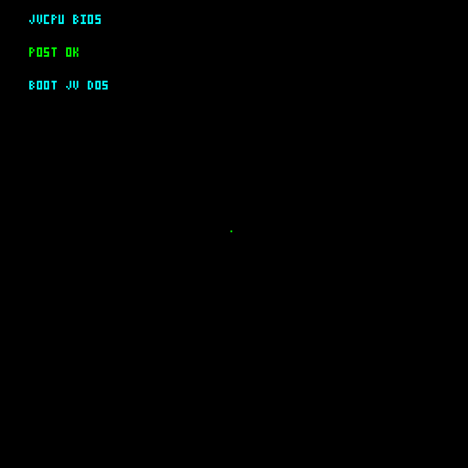
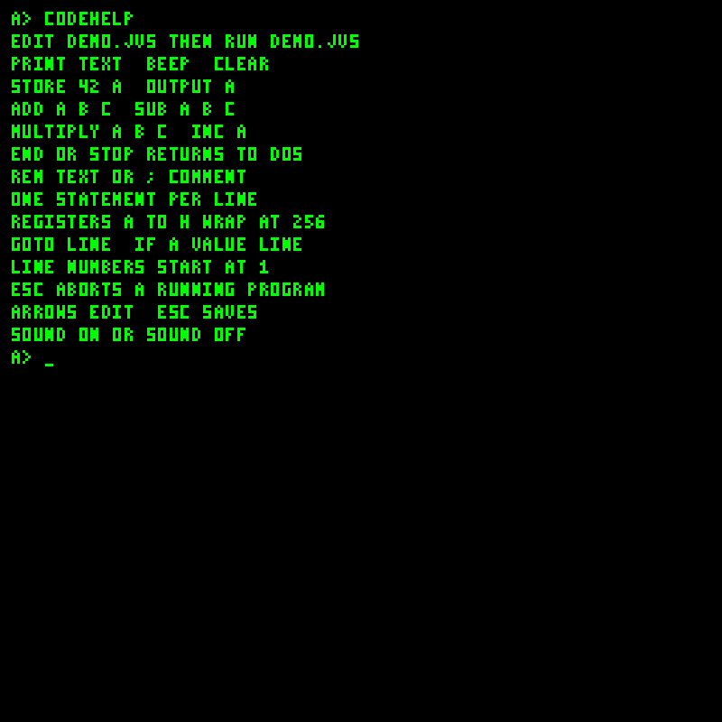

# Screenshots

These captures show the current JavaVCPU display and Disk Workshop using a separate sample disk. VM images capture the actual Swing display content at 800 × 800 pixels, without desktop borders. Workshop images show the local browser interface. Captured October 11, 2026.

## Boot and command line

| BIOS POST | JV-DOS shell |
| --- | --- |
|  |  |
| Normal boot briefly displays POST before entering DOS. | Click the display and type a command at `A>`. |

| Shell help | Programming help |
| --- | --- |
|  |  |
| `HELP` lists everyday commands; these captures show an earlier version. | Historical `CODEHELP` screen; revision 22 moves programming reference to the [JVS guide](JVS-programming.md). |

| File directory | Source editor |
| --- | --- |
|  |  |
| `DIR` lists files on the virtual disk. | `EDIT MATH.JVS`; Esc saves and returns to DOS. |

See [Getting started](Getting-started), [JV-DOS](JV-DOS) and [JVS programming](JVS-programming).

## Documents and media

| Document pager | Palette image viewer |
| --- | --- |
|  |  |
| `VIEW WELCOME.TXT`; arrows navigate, Esc closes. | `IMAGE SMILE.IMG`; Esc, Enter or Q closes. |

`PLAY THEME.JMT` displays playback status while the synthesized voices play. Esc stops playback. This is a text status view; there is no graphical transport or waveform.

See [JV-DOS](JV-DOS) and [Disk and media formats](Disk-and-media-formats).

## Running programs

| JVS source execution | COM bytecode execution |
| --- | --- |
|  |  |
| The captured arithmetic source multiplies 6 by 7. | The seeded guest executable prints a greeting and returns to DOS. |

| Built-in display greeting | Snowfall animation |
| --- | --- |
|  |  |
| `Programs.Program.DISPLAY_HELLO_CPU` | `Programs.Program.SNOWFALL`; a still frame of the pixel animation. |

The built-in graphics demos require selecting their program in the loader; they are not DOS commands. Console-only arithmetic, memory and peripheral demos have no separate display view.

See [Example programs](Example-programs) and [COM programming](COM-programming).

## Disk Workshop

Open `tools/disk-workshop/index.html` locally and select a disk. The directory and file editor share one page.

### Directory and text editor

### Palette image preview

### Tune composer

See [Tooling and Disk Workshop](Tooling-and-Disk-Workshop) for importing, applying edits and downloading the updated disk.
