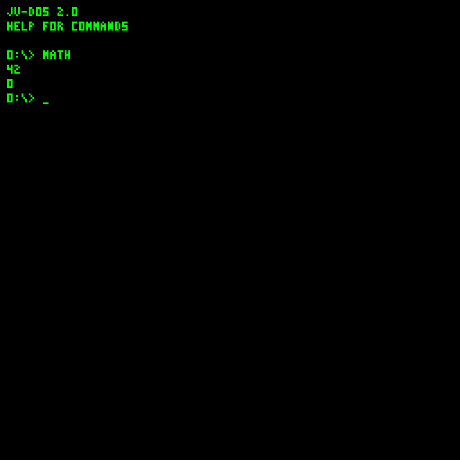
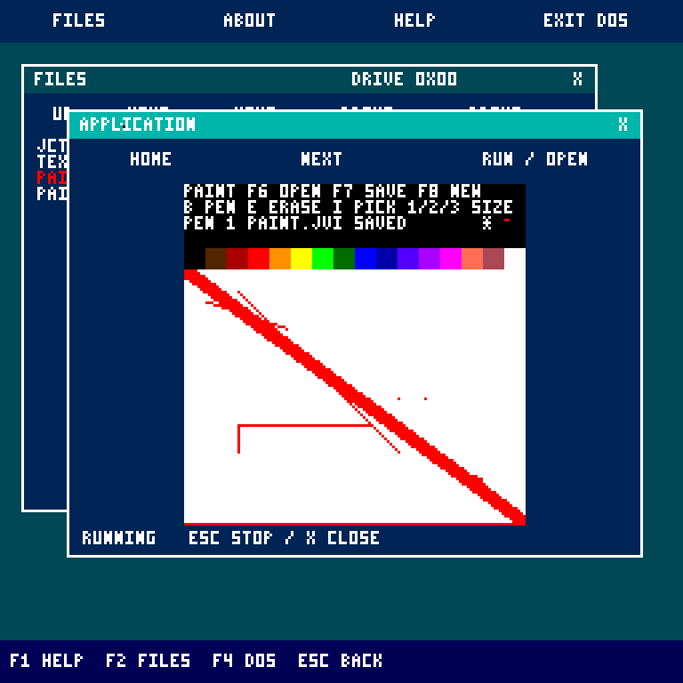
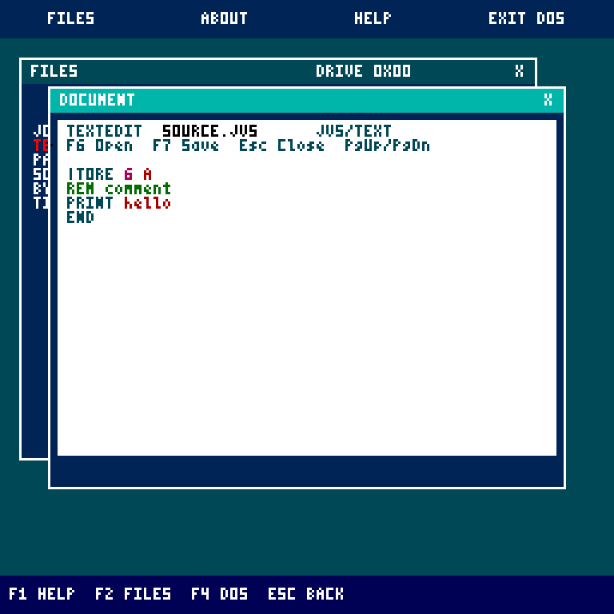
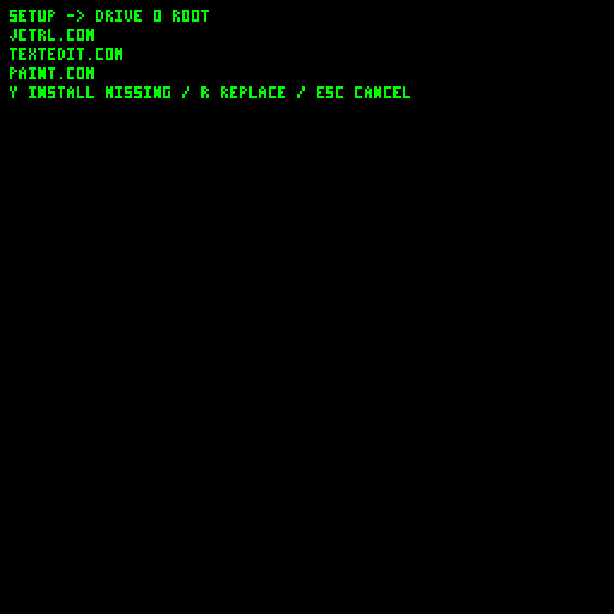
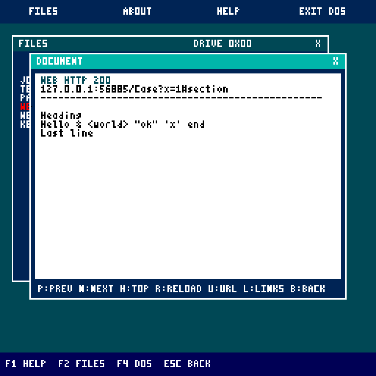
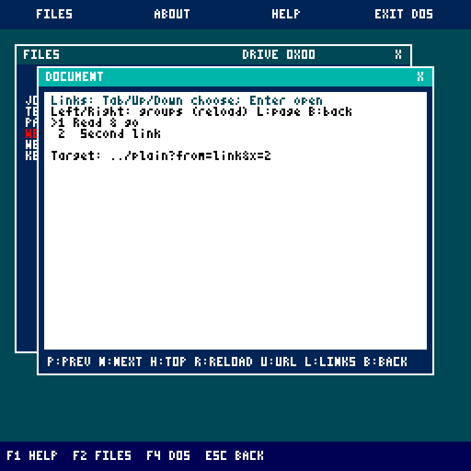
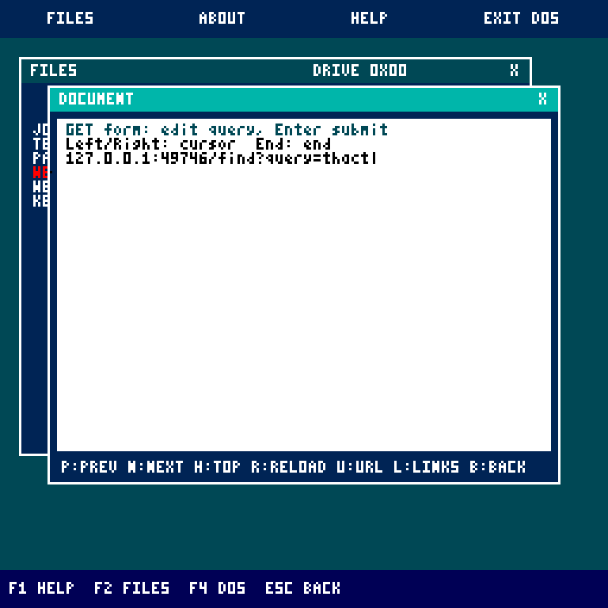
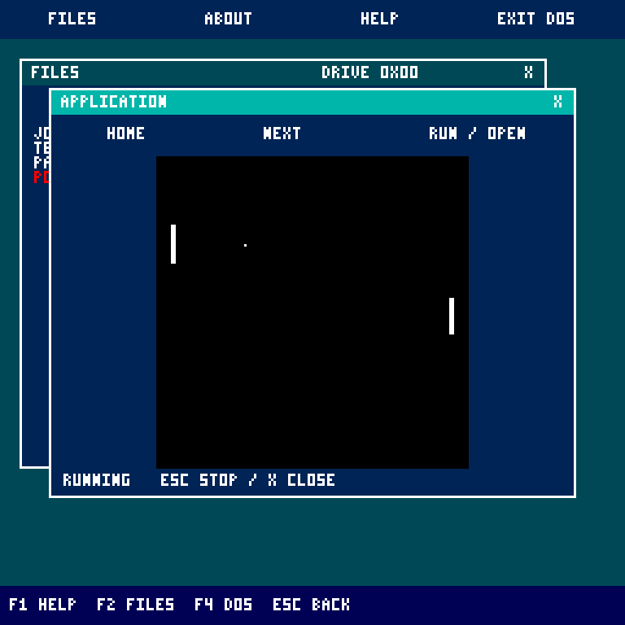

# Screenshots

Current guest captures were regenerated on **October 22, 2026** from the working-tree JavaVCPU/JV-DOS bytecode on disposable disks. They show the actual 256 by 256 palette framebuffer, enlarged exactly 3x to **768 by 768** by the headless regression runner. No host window borders are included. The normal Swing display scales to 800 by 800.

## JV-DOS 2.0

| Startup | Command help |
| --- | --- |
|  |  |
| Click the display before typing; prompt starts at `0:\>`. | HELP covers everyday commands; programming syntax lives in the [JVS guide](JVS-programming.md). |

| Directory | Source editor |
| --- | --- |
|  |  |
| One JVFS volume per disk, with folders and 24-bit file sizes. | `EDIT MATH.JVS`; Esc saves and exits. |

| JVS source execution | COM execution |
| --- | --- |
|  |  |
| Direct `MATH` resolves MATH.JVS. | Direct `HELLO` resolves HELLO.COM. |

See [Getting started](Getting-started.md), [JV-DOS](JV-DOS.md) and [COM programming](COM-programming.md).

## Documents and media

| Document pager | Palette image |
| --- | --- |
|  |  |
| Arrows/Page Up/Page Down navigate; Esc closes. | Esc, Enter or Q closes the image viewer. |

The PLAY command remains visible while music runs; there is no graphical transport or waveform. Esc stops and silences playback. See [media formats](Disk-and-media-formats.md).

## JCTRL desktop

| Files | Resident DOS window |
| --- | --- |
|  |  |

| JVS source reader | Palette viewer |
| --- | --- |
|  |  |

See [JCTRL desktop](Experimental-desktop.md) for window controls, file moves, DOS commands and application memory.

## Bundled apps and setup

| Paint | TextEdit |
| --- | --- |
|  |  |
| 128 by 96 canvas; F7 saves PAINT.JVI. | 4 KiB text/hex editor; F7 saves. |

The setup capture comes from `installerRegression`, before answering its install prompt. See [JCTRL applications](JCTRL-applications.md) and [Installers](Installers.md).

## Optional applications

| WEB reader | Link chooser |
| --- | --- |
|  |  |

| GET-form address editing | Pong |
| --- | --- |
|  |  |

WEB captures use local regression-server fixtures, not live websites. See [application controls](JCTRL-applications.md) and [the gateway helper](Tooling-and-Disk-Workshop.md#optional-web-https-gateway).

## Earlier Disk Workshop captures

These are **archival screenshots**, not a capture of the current Workshop. The following browser captures are retained from **October 11, 2026**. They show the tool's editor/preview/composer layout, before the current JVFS folder and bundle-install updates. Current controls and limits are documented in [Tooling and Disk Workshop](Tooling-and-Disk-Workshop.md).

Guest capture regeneration and wiki-image publishing are documented in [tools/wiki](../../tools/wiki/README.md).
