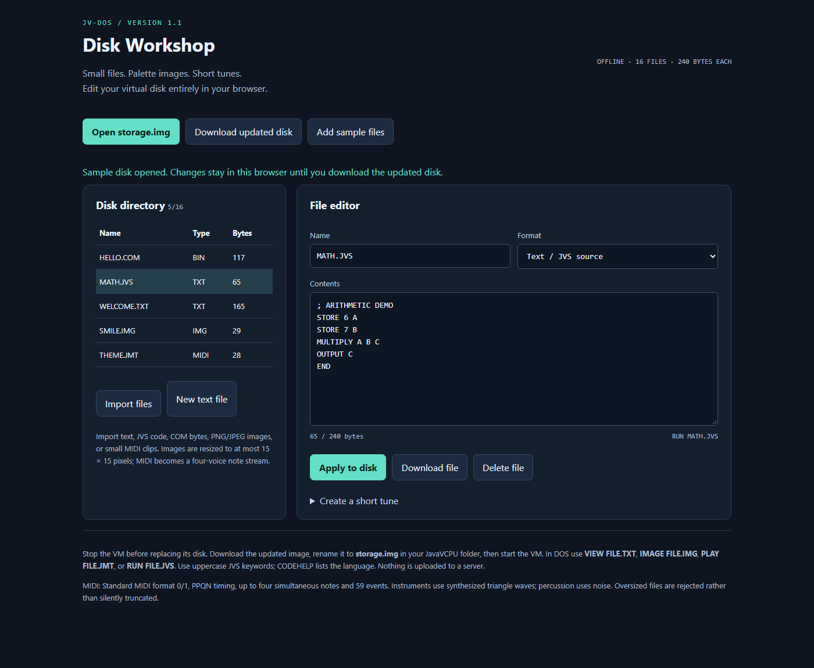
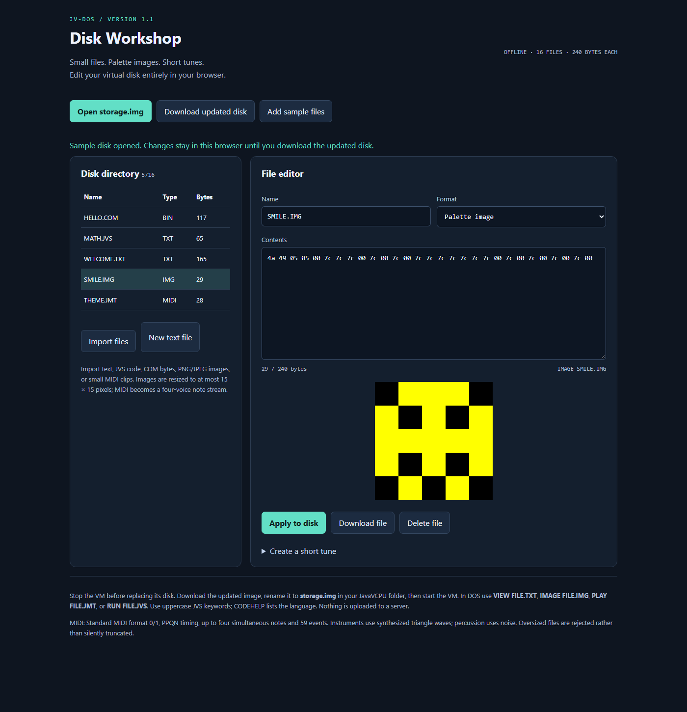
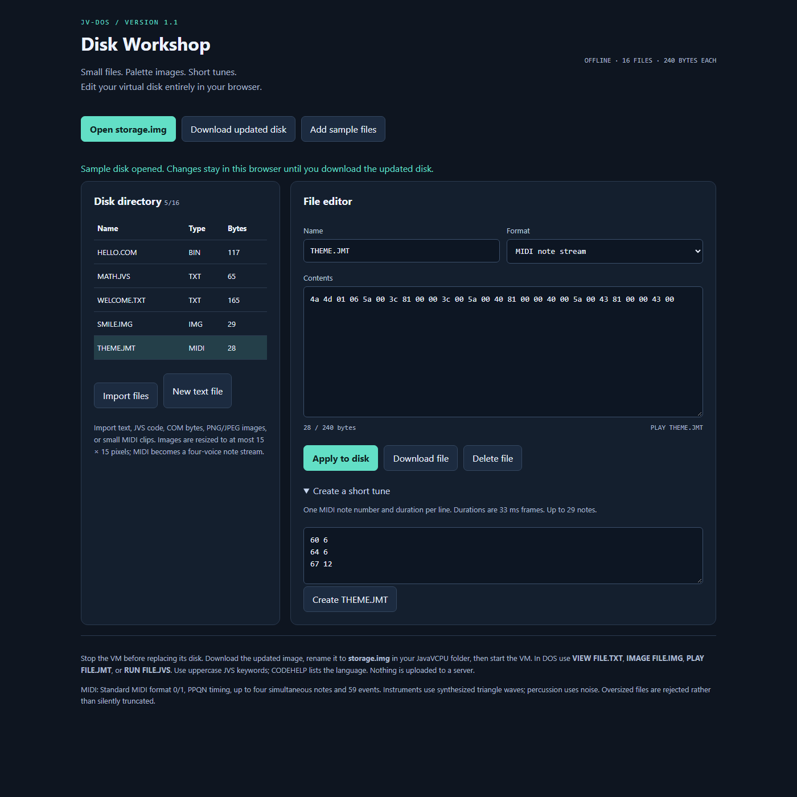

# Tooling and Disk Workshop

Disk Workshop is the browser-local tool at `tools/disk-workshop/index.html`. Open that file directly after cloning the project; keep `disk.js` beside it. It requires no web server and uploads nothing. The selected disk is copied into browser memory; edits do not replace the host file automatically.

## Import and install files

1. Run normal JavaVCPU at least once to install the system and initialize the directory, then stop the VM.
2. Back up `storage.img` and open Workshop's `index.html` in a modern browser.
3. Choose **Open storage.img** and select the project's 16 MiB disk.
4. Choose **Import files**, or **New text file**. For editor changes, choose **Apply to disk**.
5. Choose **Download updated disk**. The browser downloads `storage-updated.img`.
6. While the VM is stopped, replace the project's `storage.img` with the downloaded image using that exact name.
7. Restart JavaVCPU. Use `DIR`, then `RUN`, `VIEW`, `IMAGE` or `PLAY` for the imported file.

Each selected bank has 255 shared blocks. Files can use linked blocks up to 61,200 bytes, subject to free space. The tool preserves bytes outside its directory and initialization marker, including the BIOS/kernel. An import batch uses a working clone so a failed import does not partially apply the batch.

## Editor and conversions

Select a directory row to inspect a file. Text / JVS uses ASCII text. Binary / COM, images and tunes use two-digit hex bytes separated by whitespace in the content editor. Choose the correct format when creating a new file. Renaming in the editor requires **Apply to disk**. **Download file** exports only the selected file. **Delete file** edits the browser copy; a disk download is still required.

Imported names are normalized to an eight-character base plus a three-character extension, uppercase; unsupported base characters become underscores. The underlying format supports up to 12 name bytes. Duplicate normalized names can replace an existing file, so check the directory after imports.

| Import | Conversion / use |
| --- | --- |
| TXT, JVS, BAT, ASM, MD | UTF-8 decoded, then restricted to ASCII; CRLF becomes LF, tabs become four spaces |
| COM / other binary | Raw bytes; COM must use VM opcodes |
| PNG, JPEG, GIF, WebP, BMP | Proportional resize to at most 15 by 15, alpha composited on black, palette quantization |
| MID, MIDI | Standard MIDI format 0/1 with PPQN timing converted to JM events |
| IMG beginning `JI` | Existing guest image format |
| JMT | Existing guest music format |

MIDI supports running status, tempo changes, note-on/off and four-note polyphony. Program changes and controller effects are not preserved; percussion becomes noise. More than four simultaneous notes or more than 255 output events requires shortening the input. The tune composer takes `MIDI_NOTE FRAME_DURATION` per line, up to 127 notes; e.g. `60 6`, `64 6`, `67 12` produces `THEME.JMT`.

**Add sample files** adds `WELCOME.TXT`, `SMILE.IMG` and `THEME.JMT`. Use `VIEW WELCOME.TXT`, `IMAGE SMILE.IMG` and `PLAY THEME.JMT` after downloading/installing the disk.

| Palette preview | Short-tune composer |
| --- | --- |
|  |  |

See [Screenshots](Screenshots) for the corresponding guest document, image and playback views.

## Troubleshooting

| Symptom | Check |
| --- | --- |
| No supported BIOS header | Start the current VM normally first; a blank or older-format image is rejected |
| File too large | 61,200 bytes includes media headers and every source newline |
| Imported file absent in DOS | Apply edits, download disk, stop VM, replace correct working-directory disk, restart |
| Wrong execution behavior | Inspect file type; text is interpreted, binary is bytecode |
| Can't type | Focus the display window; hold quotes/backtick long enough for polling |
| Source error | Uppercase keywords, spaces between arguments, correct physical jump lines |
| Invalid executable | Import generated COM bytes, not text/hex or host executable bytes |

The converter checks can be run by opening `tools/disk-workshop/test.html`. It exercises the format code in a browser. See [Disk and media formats](Disk-and-media-formats) for byte layouts.
